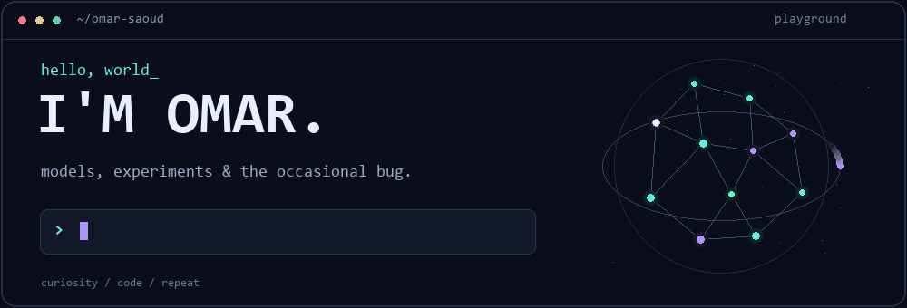

<p align="center">
  
</p>

<p align="center">
  <samp>machine learning · deep learning · mlops · a little rag</samp>
</p>

<br>

I like making models work — and figuring out why they don't.

Currently getting deeper into MLOps, with some RAG experiments on the side.
This is where the things I'm building will land.

```python
while curious:
    build()
    break_something()
    figure_it_out()
```

<p align="center">
  <sub>probably debugging something.</sub>
</p>
